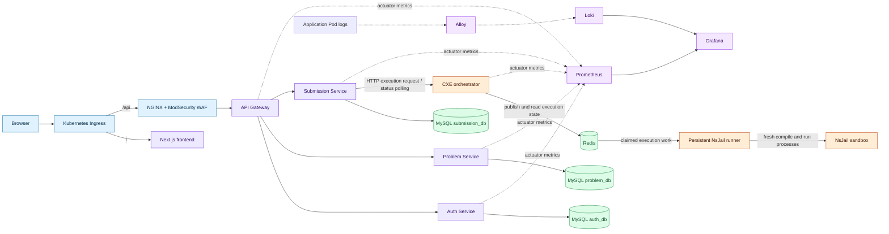

## Purpose

This C4 Level 2 view maps the independently deployed runtime containers and stores. It separates **synchronous HTTP** from **asynchronous Redis-backed execution work**. It does not imply that every arrow is a public API or that source repositories and running containers are the same thing.

The Code Execution Engine (CXE) orchestrator image and persistent NsJail runner image originate from the same `CodeExecutionEngine` source commit, but Helm defines them as independent workloads with different responsibilities and security settings.

## Container diagram

## How to read it

### HTTP edge and domain services

The Helm ingress template renders the public path mapping from chart values. The frontend receives the root path; API traffic is routed through the WAF and then the gateway. The gateway configuration selects Auth, Problem, and Submission downstream services, and applies its JWT filter to protected route groups. [Request routing and authentication](/docs/architecture/request-routing-and-authentication) explains that boundary.

### Canonical records versus coordination state

The chart declares MySQL schemas for Auth, Problem, and Submission. Their services use datasource configuration and Flyway migrations. Redis is shown separately because it coordinates execution state; it is not shown as the canonical source for account, catalogue, or submission history. [Data ownership and persistence](/docs/architecture/data-ownership-and-persistence) documents the distinction and its limits.

### The asynchronous execution path

Submission Service talks to CXE over HTTP to initiate or observe execution. CXE publishes persistent-route work to Redis, and the runner claims work from Redis before creating fresh NsJail child processes. The dashed conceptual boundary is important: browser requests are not a direct connection to a runner, and the runner has no public service in its Helm template.

### Observability path

The chart configures Prometheus to scrape `/actuator/prometheus` from the Java backends. Alloy discovers Kubernetes Pods and forwards processed logs to Loki; Grafana is provisioned with Prometheus and Loki data sources. The diagram only states configured collection paths—see [Observability architecture](/docs/architecture/observability-architecture) for exclusions and limitations.

## Design consequences

- A failed execution runner does not mean the browser must reach an untrusted process directly; it is observed through CXE status/result handling.
- The runner workload has its own service account, Pod security context, workspace volumes, probes, and egress policy in the chart. Those controls are evidence of the intended boundary, not proof of all sandbox properties on every cluster.
- Legacy queue/Job and local-process code remains in CXE as compatibility/fallback functionality. It is intentionally omitted from the default-path arrows; the [execution boundary page](/docs/architecture/execution-coordination-and-trust-boundaries) names it explicitly.

## Evidence

| Evidence | Record |
| --- | --- |
| Release | `v1.0.0-rc.8`; eight image/source mappings in `release-manifests/v1.0.0-rc.8/images.tsv` |
| Source | `helm` `f32b8db…`, runner and monitoring templates; `CodeExecutionEngine` `c8e9c06…`, runner Dockerfile and v2 sources |
| Status | Implemented but not deployment-qualified |
| Limitation | The available records prove chart/source topology, not a revision-19 live manifest or live image IDs. |

## Continue the learning path

<SourceReference
  repository="helm"
  path="algocrack/templates/cxe-nsjail-runner.yaml"
  label="Runner workload boundary source"
/>

[System context](/docs/architecture/system-context) → **Container architecture** → [Request routing and authentication](/docs/architecture/request-routing-and-authentication) → [Data ownership](/docs/architecture/data-ownership-and-persistence) → [Execution boundary](/docs/architecture/execution-coordination-and-trust-boundaries) → [Observability](/docs/architecture/observability-architecture)
