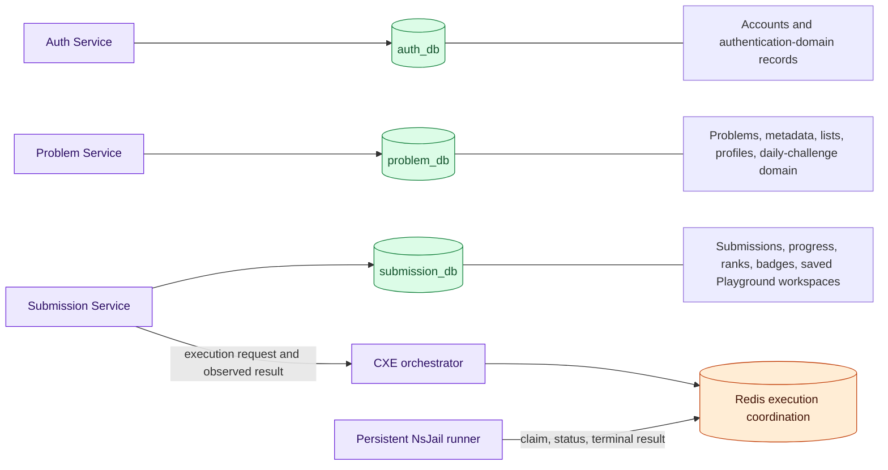

## Purpose

This page distinguishes the system's **canonical application records** from **execution coordination state**. It does not assume that every running component owns a database simply because the platform has multiple services.

**Canonical data** is the record a domain service persists and evolves through its migration boundary. **Coordination state** lets asynchronous work progress and be observed; it is not a replacement for the user-facing history a domain service owns.

## Ownership diagram

## Observed ownership boundaries

| Owner | Source-observed domain | Persistence boundary |
| --- | --- | --- |
| Auth Service | Accounts and authentication-domain behavior | `auth_db`; datasource configuration and Flyway migration location in the Auth Service |
| Problem Service | Catalogue/read models, problem lists, profile-facing problem information, and daily-challenge domain endpoints | `problem_db`; datasource configuration and Problem Service migrations |
| Submission Service | Submission records, evaluation/progress-facing behavior, ranks/badges, and Playground workspace persistence | `submission_db`; Submission Service datasource and migrations, including progress/gamification migration material |
| CXE orchestrator and persistent runner | Execution envelopes, queued/processing/terminal coordination, and execution status/result projection | Redis v2 coordination keys and TTL-bounded state; not a MySQL application-history owner |
| Frontend/WAF/Gateway | Presentation, edge inspection, and routing | No canonical application database ownership is established by the sources reviewed here |

The chart declares the three named MySQL databases. Each owning Java service uses datasource configuration and enables Flyway migration processing. That is evidence of a separate schema/migration boundary for these three domains; it is not evidence that no service ever reads a collaborator's API.

## Submission record versus execution lifecycle

An official submission is a domain record owned by Submission Service. Execution work follows a separate, asynchronous lifecycle:

1. Submission Service requests execution and later observes a CXE result.
2. CXE validates/routs the request and publishes persistent-route work to Redis.
3. The runner claims work, performs sandboxed compile/run stages, and conditionally commits a terminal execution result/status.
4. Submission Service uses execution outcomes for its domain workflow, including the trusted oracle stage for an official Submit.

Redis therefore improves coordination and recovery boundaries without making it the canonical answer to “what did this user submit?” Detailed claims about leases, retry transitions, and exact-once limits are reserved for the D3.5 execution deep dive.

## Consequences for maintainers

- Schema changes belong with the service that owns the domain and its Flyway migration history; they are not a cross-service Redis change.
- Execution data is intentionally short-lived/coordination-oriented in the architecture. A consumer should not treat it as an audit database without separately documented retention evidence.
- Progress, profile-facing data, and leaderboard/rank behavior cross service boundaries at the API level. This page documents ownership, not every read/write sequence; those are D3.3 work.
- Saved Playground snippets are submission-domain persistence, while actual program execution still crosses the CXE/runner boundary.

## Evidence

| Evidence | Record |
| --- | --- |
| Source | `helm` `f32b8db…`, database values; Auth/Problem/Submission pinned datasource and Flyway configuration; `CodeExecutionEngine` `c8e9c06…`, v2/runner sources |
| Status | Implemented but not deployment-qualified |
| Limitation | No revision-19 database/Redis runtime inventory was captured for this batch; table names and cross-service flow detail are intentionally deferred. |

## Related reading

[Request routing and authentication](/docs/architecture/request-routing-and-authentication) · [Execution boundary](/docs/architecture/execution-coordination-and-trust-boundaries) · [Observability architecture](/docs/architecture/observability-architecture)
