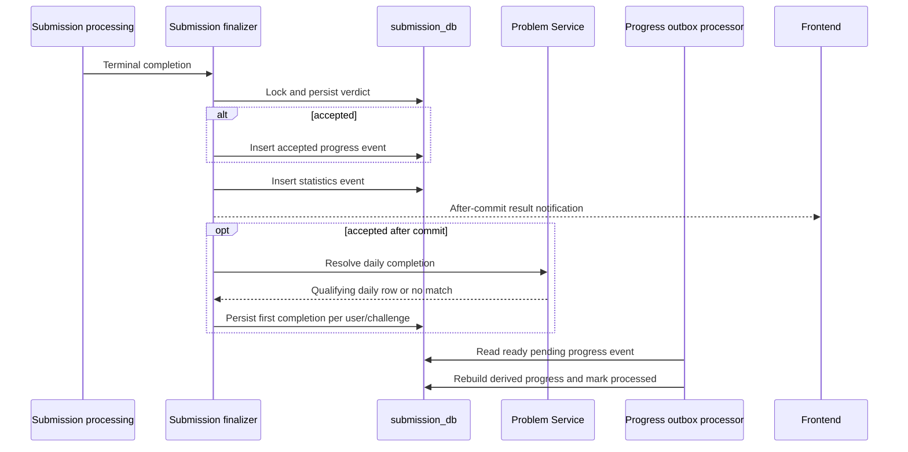

## Trigger and consistency model

This flow starts only when official judging reaches a terminal submission result. `SubmissionFinalizer` locks the submission record, refuses duplicate terminal finalization, and refuses an `ACCEPTED` verdict when the execution result was not successful. It writes the verdict, execution fields, an accepted-progress outbox record when applicable, and a statistics outbox record in the same short transaction.

The important boundary is **after commit**: WebSocket notification, immediate statistics dispatch, and daily completion recording run after the verdict transaction commits. Progress recalculation is later performed from the accepted-progress outbox. Therefore a persisted accepted verdict is not source evidence that every derived score, badge, or browser card is already refreshed.

## What changes and what does not

| Event | Direct result |
| --- | --- |
| Rejected, compile-error, runtime-error, timeout, or internal-error verdict | Terminal submission data is stored, but the accepted-progress outbox is not created. |
| Accepted official submission | A `PENDING` accepted-submission progress event is inserted, unless the unique source id already exists. |
| Accepted submission that matches the published POTD question in the UTC window | The after-commit daily completion path may store a `DailyChallengeCompletion`. |
| Repeat accepted submission for the same daily challenge | The completion table is checked by user and challenge; the source documents an idempotent first-completion rule. |
| Accepted submission for another question or another UTC day | It can still affect solve-based progress, but it is not a qualifying daily completion. |

The recalculator starts from accepted submissions, preserves the first accepted submission per question for solve state, refreshes derived rows, and asks Problem Service for rank metadata and POTD qualification. Only published questions with recognized normalized difficulty count toward mastery. The outbox processor polls pending events with a default five-second delay and processes them in a new transaction. On a recalculation failure it retains the event as pending, records an error, increments attempts, and schedules a bounded backoff; source review does not establish a terminal dead-letter policy or a live retry guarantee.

## Daily streak rules

There are two closely related calculations. The Problem Service profile-oriented calculator accepts a scheduled date-to-question map plus accepted submission days; it uses a set of dates, so duplicate solves do not create extra streak days. The Submission Service rank calculator uses persisted qualifying daily completions.

In both implementations, the current streak is nonzero only when the last qualifying day is today or yesterday; it then counts contiguous prior dates. The longest streak is the largest contiguous run. A missed calendar date breaks the run. These rules are date-based, not submission-count based.

## Authorization, storage, and presentation

The progress APIs require the gateway-injected user identity header at the controller boundary. Submission Service owns `submission_db`, the outbox, derived `UserProgress`, first-solve rows, topic rows, earned badges, and daily completion records. Problem Service owns the schedule and resolves whether a completion qualifies. The frontend profile fetches profile data first, then requests progress and badges together; it intentionally keeps the main profile visible when the secondary progress calls fail.

This is a cross-service, eventually refreshed projection rather than a cross-database transaction. The source establishes duplicate guards for accepted-progress events and daily completion; it does not establish exactly-once delivery for every service failure.

<SourceReference repository="submission" path="src/main/java/com/hrishabh/algocracksubmissionservice/service/SubmissionFinalizer.java" label="Pinned terminal verdict transaction and after-commit work" />
<SourceReference repository="submission" path="src/main/java/com/hrishabh/algocracksubmissionservice/progress/service/ProgressOutboxEventHandler.java" label="Pinned recalculation failure recording and retry timing" />
<SourceReference repository="submission" path="src/main/java/com/hrishabh/algocracksubmissionservice/progress/service/PotdCompletionService.java" label="Pinned first qualifying daily completion logic" />
<SourceReference repository="problem" path="src/main/java/com/hrishabh/problemservice/dailychallenge/service/PotdStreakCalculator.java" label="Pinned date-based POTD streak calculation" />
<SourceReference repository="frontend" path="src/components/profile/ProfilePage.tsx" label="Pinned profile and optional progress presentation" />

## Related reading

[Problem of the Day lifecycle](/docs/architecture/end-to-end-flows/problem-of-the-day-lifecycle) · [Rankings, badges, achievements, and leaderboards](/docs/architecture/end-to-end-flows/rankings-badges-achievements-and-leaderboards) · [Official Java Submit and oracle](/docs/architecture/end-to-end-flows/official-java-submit-and-oracle)
