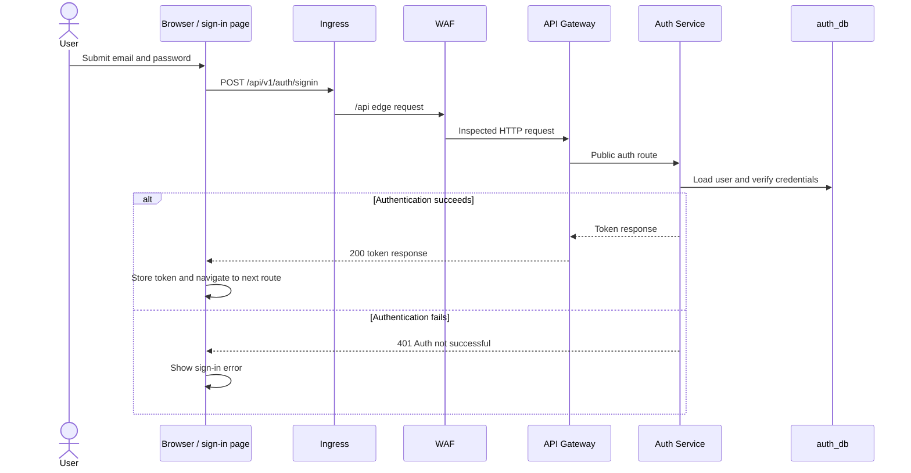
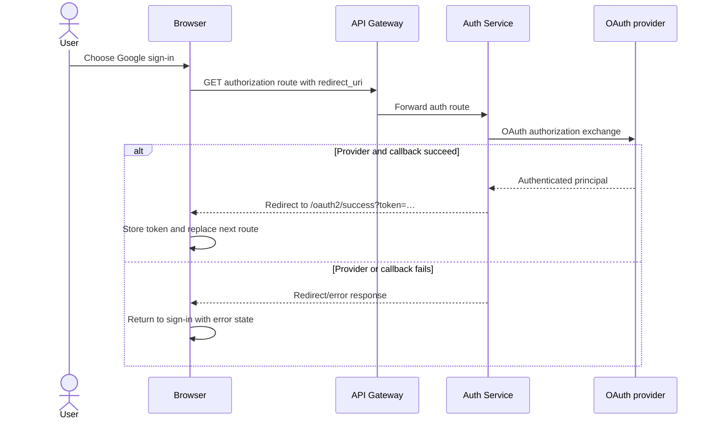

## Purpose and scope

This chapter is for an engineer tracing a browser login into a later authenticated API request. It records the RC.8 source path, not a claim about a particular OAuth client configuration or deployed cookie policy. The frontend API client stores the returned bearer token in browser local storage and attaches it to normal API requests; the Gateway route configuration applies its JWT filter to protected route groups.

The chart/source topology places `/` at the frontend and `/api` at the WAF before the Gateway. The available release artifacts do not include a revision-19 rendered Ingress or workload capture, so edge behavior is **implemented but not deployment-qualified**.

## Password sign-in

### Technical walkthrough

1. The sign-in page posts `{ email, password }` to `/api/v1/auth/signin` with `skipAuth`, so it does not attach a prior bearer token.
2. The Gateway configuration makes `/api/v1/auth/**` a route to Auth Service without the Gateway `JwtAuthentication` filter. That is route selection, not a replacement for Auth Service security.
3. `AuthController` delegates credential verification to Spring Security's authentication manager, then looks up the user in `UserRepository` to create token claims containing the application user id and role.
4. The controller returns an `AuthResponseDto` token. Its source also sets a JWT response cookie for backward compatibility; this page intentionally does not generalize its attributes beyond the pinned code.
5. `AuthContext.login` receives the token on the browser path. The shared API client adds `Authorization: Bearer …` on later non-skipped requests.
6. A protected API request travels through the WAF/Gateway route. If the API client receives `401`, it clears the browser token and redirects to `/auth/signin` with the current path as `next`.

## Google OAuth callback path

The frontend's Google button builds a browser callback URL at `/oauth2/success` and navigates to the Gateway's Google authorization endpoint. Auth Service source permits the OAuth route groups; its success handler accepts only the configured localhost-origin callback shape in this RC.8 source, appends a token to the redirect target, and redirects the browser. The frontend callback page reads `token` or `error`, calls `login` for a token, and replaces the route.

The provider interaction, client registration, and a production callback origin are configuration-dependent. They are not proven active by the RC.8 source snapshot. A redirect mismatch is therefore an integration/configuration error, not a browser-side credential verdict.

## Contracts, state, and errors

| Boundary | Verified source contract | Data boundary |
| --- | --- | --- |
| Password sign-in | `POST /api/v1/auth/signin` returns a token-bearing success response or an authentication failure | User lookup is through Auth Service's `UserRepository` in `auth_db`. |
| OAuth completion | Browser callback consumes `token`, `error`, and optional `next` query parameters | The browser is redirected; the frontend callback does not call a separate session API. |
| Protected request | Browser API client sends `Authorization` unless `skipAuth` is selected | Gateway applies its configured JWT filter before protected downstream routes. |

- An invalid credential becomes an Auth Service authentication failure; the sign-in page maps it to user-facing error text.
- A missing/invalid/expired bearer token is handled at the browser/Gateway boundary; the client reacts to `401` by removing its local token and navigating to sign-in.
- OAuth provider, callback, and redirect configuration failures are not fully classified by this source-only evidence. Treat them as unresolved deployment configuration unless a release record captures the actual settings.

## Security and design boundaries

The browser owns route navigation and local token handling; it is not the authorization authority. The WAF may reject an API request before the Gateway, the Gateway decides which configured routes receive its JWT filter, and Auth Service owns identity credentials and token creation. Do not expose provider secrets, JWT keys, or callback values in flow documentation.

<SourceReference repository="frontend" path="src/app/auth/signin/page.tsx" label="Pinned frontend sign-in entry point" />
<SourceReference repository="auth" path="src/main/java/com/hrishabh/algocrack/controller/AuthController.java" label="Pinned Auth Service password sign-in controller" />
<SourceReference repository="auth" path="src/main/java/com/hrishabh/algocrack/config/OAuth2AuthenticationSuccessHandler.java" label="Pinned Auth Service OAuth success handler" />

## Related reading

[Request routing and authentication](/docs/architecture/request-routing-and-authentication) · [System context](/docs/architecture/system-context) · [Getting started](/docs/using/getting-started) · [Troubleshooting](/docs/using/troubleshooting)
