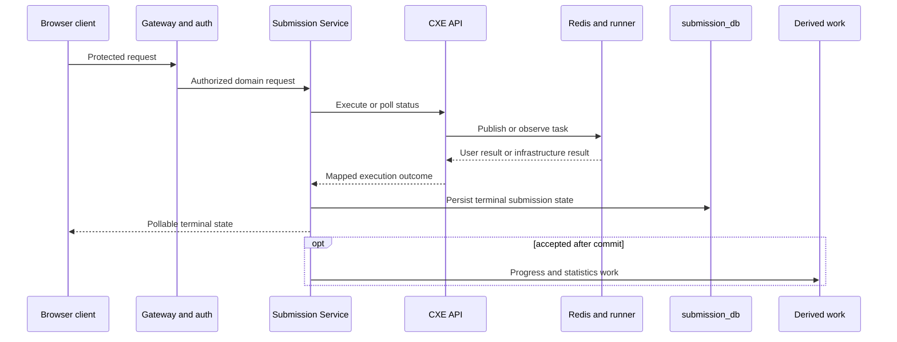

## Scope and classification

This chapter follows observed responsibility boundaries. It does not claim a universal error envelope, a live route selection, or an end-to-end retry guarantee; those require sanitized runtime traces. It also intentionally leaves Redis v2 lease algorithms to [execution coordination](/docs/architecture/execution-coordination-and-trust-boundaries).

| Class | Examples | Primary handling boundary |
| --- | --- | --- |
| Authentication or route rejection | Missing/invalid browser token, an unavailable protected route | Gateway/auth boundary and frontend API client. |
| Domain validation | Unknown question, invalid list input, forbidden/foreign owned resource | The owning Problem or Submission controller/service. |
| User program outcome | Compilation failure, runtime failure, time limit | CXE result is mapped into the Run/Submit contract; it is not the same as an orchestration outage. |
| Execution infrastructure | Worker/runner availability, result retrieval, unexpected execution failure | CXE and Submission processing; official submit can finalize as an internal error. |
| Derived-state failure | Progress recomputation or post-commit statistics work | Outbox/after-commit work; terminal verdict remains a separate persisted result. |

## Official Submit failure path

Official Submit is asynchronous. Submission Service persists `QUEUED`, dispatches processing after commit, then polls CXE status/results through its adapter. User compilation, runtime, and timeout outcomes are terminal judging inputs and do not enter oracle comparison. A user success is followed by a sequential trusted-oracle execution; an oracle failure is treated as internal rather than accepting the user answer.

`SubmissionFinalizer` locks and writes terminal state once, refusing duplicate finalization or an accepted result that lacks successful execution. Unexpected processing errors are handled as an internal failure by the submission path. Statistics dispatch and daily completion execute after the verdict transaction, so their failure should not be read as a reversal of an already stored terminal verdict.

## Delays, stale state, and cancellation limits

The browser's Submit helper polls the persisted submission resource on its own bounded schedule. A poll timeout means the browser has stopped waiting; it is not source evidence that the server-side job was cancelled. The browser can later retrieve the persisted record if the service completes it.

CXE source contains persistent-runner task status, conditional result completion, cancellation, and recovery components. The available source evidence supports describing those as the execution coordination boundary, but not publishing their full Redis transition algorithm here or asserting a deployed retry policy. In particular, an in-flight v2 task, a stale worker result, and a missing terminal result are different operational states; the definitive inspection point is CXE status/result handling, not a frontend toast.

## Browser and product recovery behavior

- The frontend API client clears local token state and redirects to sign-in for a 401 response; other non-success responses become client errors for the caller to present.
- Profile treats progress/badge retrieval as optional after core profile success, while the daily card treats its public daily fetch failure as no available challenge.
- List mutations and user actions rely on the request result; source review does not show an offline mutation queue or automatic replay.
- Progress-outbox failure retains the pending event, records a truncated error and incremented attempt count, and applies a bounded delay before another processor pass. That is retry scheduling code, not proof of eventual completion under every outage.

## Evidence limitations and operator handoff

The RC.8 source does not provide an end-to-end capture for every WAF, Gateway, browser, CXE, and database failure response. It therefore cannot establish exact status bodies, correlation identifiers, production worker timeout behavior, or a complete cancellation contract. Those gaps are tracked in the D3 evidence register and should be filled with sanitized contract tests or read-only traces before stronger operational claims are published.

<SourceReference repository="frontend" path="src/lib/api-client.ts" label="Pinned browser error and authentication-client behavior" />
<SourceReference repository="submission" path="src/main/java/com/hrishabh/algocracksubmissionservice/service/SubmissionProcessingService.java" label="Pinned official processing failure boundary" />
<SourceReference repository="submission" path="src/main/java/com/hrishabh/algocracksubmissionservice/service/SubmissionFinalizer.java" label="Pinned terminal-state and after-commit boundary" />
<SourceReference repository="cxe" path="src/main/java/xyz/hrishabhjoshi/codeexecutionengine/controller/ExecutionController.java" label="Pinned CXE execution API boundary" />

## Related reading

[Authentication and session establishment](/docs/architecture/end-to-end-flows/authentication-and-session-establishment) · [Java Run](/docs/architecture/end-to-end-flows/java-run) · [Official Java Submit and oracle](/docs/architecture/end-to-end-flows/official-java-submit-and-oracle) · [Execution coordination and trust boundaries](/docs/architecture/execution-coordination-and-trust-boundaries)
