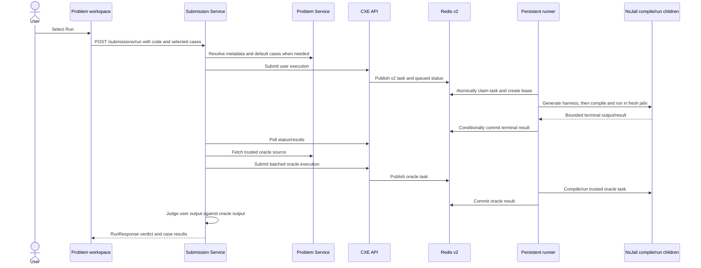

## Purpose and scope

**Run** evaluates the code and cases currently selected in the problem workspace. It is synchronous at the browser/Submission Service boundary, but its execution request is asynchronous at the CXE/runner boundary and is polled by the Submission Service. The flow is designed for a Java problem harness, not a raw Playground program.

This page describes the persistent route when the execution router selects `PERSISTENT_NSJAIL`. The code also retains legacy paths; source inspection alone does not prove a particular deployed route selection.

## Run sequence

## Technical walkthrough

1. `ProblemActions` obtains the editor language/source and `getTestcasesForRun()`, then posts `questionId`, `language`, `code`, and `customTestCases` to `/api/v1/submissions/run`.
2. `UnifiedExecutionService` uses supplied non-empty custom cases. Otherwise it asks Problem Service for `DEFAULT` cases. It rate-limits/validates the Run request and checks that a reference solution exists before incurring execution work.
3. Submission Service requests language-specific question metadata from Problem Service, builds a `CodeBundle`, and sends the user execution through its CXE adapter.
4. CXE validates the execution mode, resolves a backend, and—on the persistent route—writes a versioned envelope/status to Redis v2. Its HTTP response is `202 Accepted`; Submission Service polls CXE's status/results API until terminal.
5. The runner atomically moves one ready id to its processing list, finalizes a lease/attempt token, creates a task workspace, generates trusted harness source, and launches separate fresh NsJail compile and run stages for Java.
6. The runner commits a terminal result only for the current attempt. Submission Service receives the mapped result through CXE, then executes the trusted oracle as a distinct batch and judges corresponding outputs.
7. The Run response carries a Run-specific verdict, result details where available, and compiler/error text. The frontend maps it into its result store and opens the results tab.

## Predefined versus custom cases

| Case selection | Source-observed behavior |
| --- | --- |
| Custom cases present | Submission Service maps each browser-provided input to a `TestCaseInput` marked custom. |
| No custom cases | Submission Service asks Problem Service for `DEFAULT` cases. |
| Official hidden cases | Not part of Run; they belong to official Submit. |
| Expected output | The service executes the trusted reference/oracle batch rather than treating browser-entered output as an official answer. |

The frontend is responsible for the currently selected/editor case payload; Problem Service remains the owner of stored question/testcase/metadata data. Neither source path establishes that client-supplied cases are persisted by Run.

## Result, errors, and timing boundaries

| Boundary | Behavior evidenced in source |
| --- | --- |
| Browser to Submission Service | Synchronous `POST /run`; the browser waits for `RunResponseDto`. |
| Submission Service to CXE | Adapter submits work and polls CXE status/results. |
| CXE to runner | Redis v2 task/status coordination; the worker is not an HTTP request handler. |
| Runner to NsJail | Fresh compile and run child stages; output is bounded before mapping. |

- **Compilation error:** CXE execution status maps to `COMPILATION_ERROR_RUN`, with compilation output when present.
- **Runtime error / timeout / memory outcome:** the Run mapper returns its matching Run verdict; source does not promise that every memory value is available.
- **Unsupported language or malformed execution request:** CXE policy/routing or the runner's contract handling rejects it; the precise HTTP/error shape should be taken from the receiving service, not guessed from this diagram.
- **Infrastructure/oracle error:** an absent oracle or an exception becomes `INTERNAL_ERROR_RUN`; this must not be read as a user-code correctness verdict.

## Trust boundaries and consequences

Submission Service owns test/oracle acquisition and result comparison. CXE owns execution admission/status projection, while the runner owns task/workspace/sandbox lifecycle. User source crosses into a task workspace and NsJail child, not into the Submission Service process. The independently executed oracle makes Run useful for comparison, but a successful Run does not create an official submission record or progress update.

<SourceReference repository="frontend" path="src/components/problems/problem-actions.tsx" label="Pinned Run button and result-store path" />
<SourceReference repository="submission" path="src/main/java/com/hrishabh/algocracksubmissionservice/service/UnifiedExecutionService.java" label="Pinned synchronous Run orchestration" />
<SourceReference repository="cxe" path="src/main/java/xyz/hrishabhjoshi/codeexecutionengine/controller/ExecutionController.java" label="Pinned CXE submit/status/results API" />
<SourceReference repository="cxe" path="nsjail-runner/src/main/java/xyz/hrishabhjoshi/codeexecutionengine/runner/TaskExecutionPipeline.java" label="Pinned runner compile/run pipeline" />

## Related reading

[Official Java Submit and oracle](/docs/architecture/end-to-end-flows/official-java-submit-and-oracle) · [Execution coordination](/docs/architecture/execution-coordination-and-trust-boundaries) · [Run versus Submit](/docs/using/run-and-submit)
