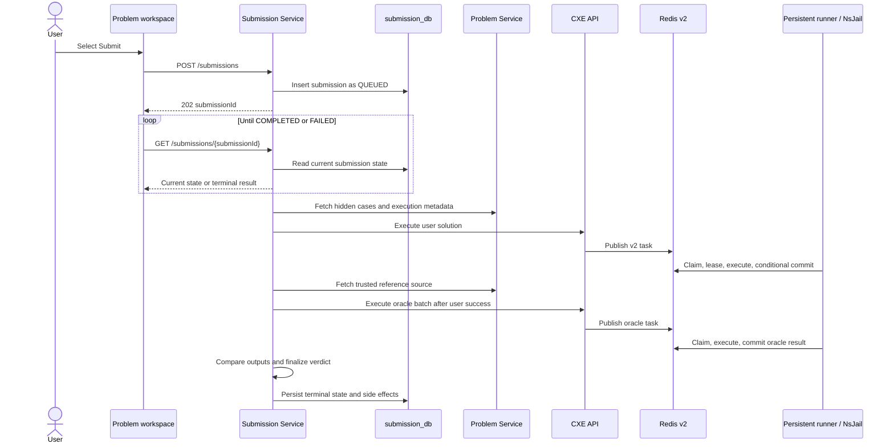

## Purpose and scope

Official Submit creates a persisted submission and returns an acknowledgement before evaluation completes. It is the flow that can produce an official verdict. The source shows a user-code batch followed by a **sequential** trusted-oracle batch; it does not establish parallel execution or a latency guarantee.

The persistent NsJail description below is conditional on the configured `PERSISTENT_NSJAIL` route. Kubernetes Job/local compatibility paths remain in source as legacy/fallback behavior.

## Official judging sequence

## Technical walkthrough

1. The authenticated frontend posts `userId`, `questionId`, language, and editor code to `POST /api/v1/submissions`. It receives `202 Accepted` with a submission id, then polls the submission record once per second up to the client helper's default limit.
2. `SubmissionService.createAndProcess` creates a UUID, stores a `QUEUED` `Submission` in `submission_db`, and schedules processing only after the database transaction commits.
3. `SubmissionProcessingService.processSubmission` loads a snapshot, avoids work for an already-terminal record, progresses through compiling/running state, fetches question metadata and cases from Problem Service, and builds the user bundle.
4. The user bundle travels through the same execution adapter/CXE API used by Run. On a persistent route, CXE publishes the v2 envelope to Redis; the runner claims the task with an attempt/lease and performs generated-harness compilation/run in fresh NsJail stages.
5. If user execution succeeds, Submission Service fetches the trusted reference solution and executes it once against the batch of inputs. This happens after—not in parallel with—the user stage in `processSubmission`.
6. The judging pipeline compares user and oracle outputs case by case and `SubmissionFinalizer` writes a terminal verdict. The frontend's poll reads that persisted submission outcome rather than querying the runner directly.

## Success, wrong answer, and infrastructure failure

| Outcome | Source-observed processing behavior |
| --- | --- |
| Accepted | User and oracle execution succeed and every judged output satisfies the pipeline; the finalizer persists the terminal result. |
| Wrong answer | User execution succeeds but comparison finds a non-matching result; the finalizer persists the resulting non-accepted verdict. |
| User compilation/runtime/timeout | Processing maps the execution status to a submission verdict and finalizes without entering oracle comparison. |
| Oracle failure | The source treats it as an internal error rather than declaring user code accepted or wrong. |
| Unexpected orchestration failure | The processing service catches it and finalizes an internal-error completion; source does not prove retry/exactly-once behavior for the whole domain workflow. |

Progress/statistics work is intentionally not generalized here. The documented source says the verdict finalizes before question-statistics work so a statistics conflict does not roll the submission back to `QUEUED`; accepted-state refresh on the frontend is a UI effect, not proof that every failure mode changes progress identically.

## Contracts and boundaries

| Boundary | Contract/state |
| --- | --- |
| Browser → Submission Service | `POST /submissions` returns a submission id and initial status; `GET /submissions/{id}` returns persisted state. |
| Submission Service → Problem Service | Metadata, official cases, and trusted reference-source acquisition. |
| Submission Service → CXE | Execution request plus polling of CXE status/results; not a direct runner call. |
| CXE → Redis/runner | Versioned task, status, claim/lease, and terminal-result handoff. |
| Submission Service → database | Submission lifecycle and terminal judgement persistence. |

Official Submit differs from **Run** because it persists/returns an asynchronous submission and uses the official test workflow. It differs from **Playground** because Playground accepts a complete raw Java program/stdin, has no problem oracle or verdict persistence, and does not award problem progress.

## Security and design consequences

The browser does not supply the expected official answer. Problem Service supplies the trusted reference material to Submission Service, and untrusted user source enters the execution boundary through CXE. The task queue separates long-running execution from the request that created the domain submission. This is a source-level responsibility split, not a claim that all persistence/queue outcomes are exactly-once.

<SourceReference repository="frontend" path="src/components/problems/problem-actions.tsx" label="Pinned Submit acknowledgement and polling path" />
<SourceReference repository="submission" path="src/main/java/com/hrishabh/algocracksubmissionservice/service/SubmissionService.java" label="Pinned submission persistence and after-commit dispatch" />
<SourceReference repository="submission" path="src/main/java/com/hrishabh/algocracksubmissionservice/service/SubmissionProcessingService.java" label="Pinned sequential user/oracle processing" />
<SourceReference repository="submission" path="src/main/java/com/hrishabh/algocracksubmissionservice/service/OracleExecutionService.java" label="Pinned trusted oracle batch construction" />
<SourceReference repository="cxe" path="src/main/java/xyz/hrishabhjoshi/codeexecutionengine/service/v2/ExecutionV2Publisher.java" label="Pinned v2 task publisher" />

## Related reading

[Java Run](/docs/architecture/end-to-end-flows/java-run) · [Execution coordination](/docs/architecture/execution-coordination-and-trust-boundaries) · [Data ownership](/docs/architecture/data-ownership-and-persistence) · [Run versus Submit](/docs/using/run-and-submit)
