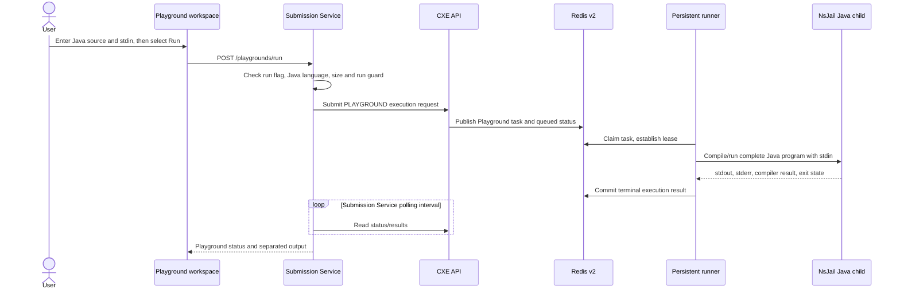

## Purpose and scope

Playground runs a complete Java program with raw stdin and returns stdout/stderr separately. It is a scratch-program flow, not a problem submission. The page is visible only through a frontend runtime feature configuration, while API and execution enablement are independent backend controls. A visible page therefore does not establish that the API or worker is enabled.

This chapter records the Java path implemented in the RC.8 source. It deliberately does **not** describe Python execution as available: `PlaygroundRunService` rejects a non-Java language before a sandbox task starts.

## Java execution sequence

## Technical walkthrough

1. The Playground client calls `POST /api/v1/playgrounds/run` with the selected language, source code, and stdin. The ordinary API client attaches the current bearer token.
2. `PlaygroundController` exists only when the `playground.api-enabled` property is true. Its `run` method requires the authenticated user header and delegates to `PlaygroundRunService`.
3. The run service independently checks `playground.run-enabled`, normalizes the language, requires `JAVA`, validates source/stdin byte limits, and uses a per-user run guard before creating a `PLAYGROUND` CXE request.
4. CXE's router selects persistent NsJail only when v2, the persistent runner, and the Playground mode backend are enabled. Its Java-only router guard sends a non-Java Playground language to the Kubernetes Job backend; Submission Service rejects Python earlier for this endpoint.
5. The v2 publisher stores a compact Playground payload (language/source/stdin) in a task envelope. The runner identifies `PLAYGROUND` mode and invokes its dedicated raw-program executor rather than the question-harness pipeline.
6. Submission Service polls CXE until a terminal status or its configured poll deadline. It maps stdout, stderr, compilation output, runtime/memory, exit code, and output-truncation indicator into `PlaygroundRunResponse`.
7. The workspace output panel presents the response. It does not create an official submission or invoke an oracle.

## Contract and error behavior

| Situation | Boundary and observed outcome |
| --- | --- |
| Feature/API disabled | Controller registration is conditional; the frontend visibility flag cannot turn the API on. |
| Run disabled | `PlaygroundRunService` rejects the request before CXE submission. |
| Python/other language | The service returns a validation failure stating Java-only execution; a sandbox process is not started. |
| Concurrent or rate-limited run | The run guard rejects before CXE work is created. |
| Queue full | A CXE 400 carrying `EXECUTION_QUEUE_FULL` is mapped to a validation error. |
| Compile/runtime/timeout | A terminal CXE result maps to status plus compiler/stdout/stderr fields. |
| Poll deadline/status loss | The service reports execution-status unavailable or timed out waiting for results. |

The timeout configuration is owned by the service/runtime configuration, not by the browser. The D2 user guide documents the RC.8 five-second Playground limit; this flow does not turn it into a general service-level promise.

## Trust boundaries and design consequences

The frontend feature flag controls discovery, not authorization. Submission Service authenticates/validates the request and remains the HTTP/polling boundary. CXE and Redis coordinate work; the persistent runner owns the workspace and sandbox launch. User stdin/source is transient execution input, and runner output is a result artifact—not a trusted expected answer.

Playground intentionally differs from Run/Submit: it has no question metadata, official cases, trusted oracle, official verdict, submission record, or progress/statistics side effect.

<SourceReference repository="frontend" path="src/lib/api/playground-service.ts" label="Pinned Playground API client" />
<SourceReference repository="submission" path="src/main/java/com/hrishabh/algocracksubmissionservice/playground/service/PlaygroundRunService.java" label="Pinned Java-only Playground run service" />
<SourceReference repository="cxe" path="src/main/java/xyz/hrishabhjoshi/codeexecutionengine/service/v2/ExecutionBackendRouter.java" label="Pinned execution-mode router" />
<SourceReference repository="cxe" path="src/main/java/xyz/hrishabhjoshi/codeexecutionengine/service/v2/ExecutionV2Publisher.java" label="Pinned Playground v2 envelope publisher" />

## Related reading

[Playground snippet persistence](/docs/architecture/end-to-end-flows/playground-snippet-persistence) · [Java Run](/docs/architecture/end-to-end-flows/java-run) · [Playground user guide](/docs/using/playground) · [Request routing](/docs/architecture/request-routing-and-authentication)
