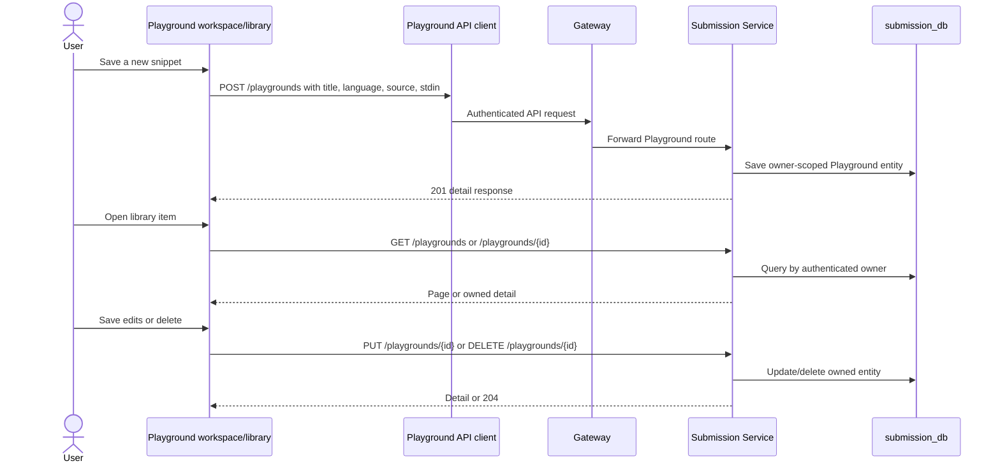

## Purpose and scope

Saving a Playground snippet stores code, language, title, and stdin for its owner. It is a separate workflow from running code: a saved snippet is not an official submission and saving does not start CXE/NsJail. This chapter is for engineers changing the saved-workspace API or ownership checks.

The following represents the implementation at the RC.8 source pin. It does not claim a particular database migration/live deployment is verified.

## Create, list, open, update, and delete

## Technical walkthrough

1. The frontend client exposes `list`, `get`, `create`, `update`, and `delete` separately from `runPlayground`. Each uses `/api/v1/playgrounds` and the authenticated common API client.
2. `PlaygroundController` extracts the trusted current-user header for every workspace operation. It passes that user id to `PlaygroundWorkspaceService`; it does not accept an owner id from the snippet body.
3. Creation checks the configured per-user saved-snippet limit, normalizes a nonblank bounded title, permits `JAVA` or `PYTHON` as stored languages, bounds UTF-8 source/stdin bytes, and persists a `Playground` entity.
4. Listing uses owner-scoped pagination ordered by updated time then id. Reading, updating, and deleting use `findByIdAndUserId`; an id owned by another user follows the not-found path rather than becoming a cross-user read/update/delete.
5. Update validates the replacement fields and persists them. Delete removes the owned entity and returns no content. The API result is a saved-workspace state, not execution output.

## Contracts and state

| Operation | HTTP route | Persistent effect |
| --- | --- | --- |
| Create | `POST /api/v1/playgrounds` | New owner-scoped row with title, language, source, stdin, timestamps. |
| List | `GET /api/v1/playgrounds?page=&size=` | Owner-scoped, bounded page of summaries. |
| Open | `GET /api/v1/playgrounds/{id}` | Owner-scoped detail includes code and stdin. |
| Save edit | `PUT /api/v1/playgrounds/{id}` | Replaces validated stored workspace fields. |
| Delete | `DELETE /api/v1/playgrounds/{id}` | Deletes only an entity found for the authenticated owner. |

The frontend workspace warns before replacing dirty editor state according to the D2 UI evidence, but the server does not receive a browser "dirty" marker. A client-side save failure leaves the browser responsible for retaining unsaved text; the persistence layer only reflects successful requests.

## Errors and security boundaries

- **Unauthenticated request:** the Gateway's Playground route is JWT-filtered and the controller requires the current-user header.
- **Not found/ownership mismatch:** `findByIdAndUserId` invokes the Playground not-found path; the source does not return another user's content.
- **Validation:** blank/overlong title, unsupported stored language, and oversize source/stdin are rejected before persistence.
- **Capacity:** creation rejects a user who has reached the configured saved-workspace limit.
- **Execution is separate:** stored Python may be created/edited even though Playground execution is Java-only. Saving does not bypass the run-language validation.

The data belongs to Submission Service's persistence boundary. It must not be confused with Redis v2 transient execution state or the runner workspace, both of which belong to the execution path.

<SourceReference repository="frontend" path="src/lib/api/playground-service.ts" label="Pinned frontend saved-workspace client" />
<SourceReference repository="submission" path="src/main/java/com/hrishabh/algocracksubmissionservice/playground/controller/PlaygroundController.java" label="Pinned authenticated Playground controller" />
<SourceReference repository="submission" path="src/main/java/com/hrishabh/algocracksubmissionservice/playground/service/PlaygroundWorkspaceService.java" label="Pinned ownership-scoped workspace persistence service" />

## Related reading

[Playground Java execution](/docs/architecture/end-to-end-flows/playground-java-execution) · [Data ownership and persistence](/docs/architecture/data-ownership-and-persistence) · [Playground user guide](/docs/using/playground) · [Troubleshooting](/docs/using/troubleshooting)
