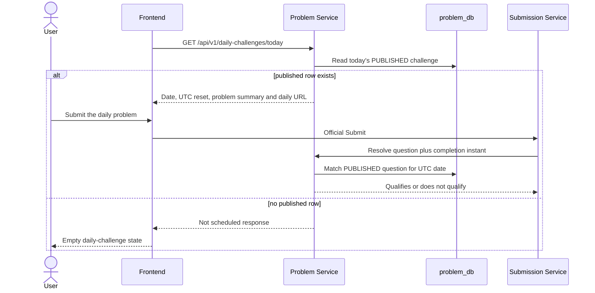

## Purpose and ownership

The **Problem Service** owns the daily schedule in `problem_db`. A daily row binds one question to one challenge date and carries a publication state. Submission Service can ask Problem Service whether an accepted submission qualifies, but it does not choose or publish the challenge.

The source has a scheduler, planner, and administrative generation path. They are **implemented but not deployment-qualified**: the scheduler is disabled by default and source review does not prove that an RC.8 workload enables it. The public read path exposes only `PUBLISHED` rows.

## Public read and solve path

The primary browser entry is `GET /api/v1/daily-challenges/today`. The frontend calls it without an auth token and deliberately converts any client failure into `null`; `DailyChallengeCard` renders “No challenge is scheduled” for that state. That makes the card tolerant of a missing schedule, but it also means the card itself does not distinguish a 404 from another fetch failure.

`GET /context?date=…&questionId=…` validates a daily URL against the published row and returns whether it is valid, historical, or active today. `GET /{date}` and a bounded date range support historical reads; future dates are not returned by the read service.

## Date model and qualification

The default scheduler clock zone is `UTC`, and public responses calculate `startsAt` and `nextResetAt` from UTC midnight. The completion resolver derives the candidate challenge date from the accepted submission instant in UTC, then matches a **published** row for both that date and question id. The qualifying interval is `[UTC midnight, next UTC midnight)`.

This has two consequences:

- Solving the right problem outside its scheduled UTC day does not qualify as that day's POTD completion.
- A future completion date is rejected by the resolver; only a row that is currently published and matches the question can qualify.

The display reset is therefore server-defined, not a browser-local calendar rule. The frontend uses the returned reset instant to present a local countdown.

## Planning and publication

When enabled, `PotdSchedulerJob` uses a named MySQL lock and asks the admin service to generate **draft** assignments from tomorrow through the configured horizon. It does not publish them by itself. The planner builds a state from historical and fixed assignments, excludes candidates that fail hard constraints, ranks eligible candidates, and selects the highest-ranked candidate for each date. If no candidate is eligible, planning fails for that date rather than silently selecting one.

The default planning configuration is evidence-backed but operationally configurable: a 45-day draft horizon; a 20/60/20 easy/medium/hard target; and weighted quality, difficulty-deficit, topic-deficit, freshness, reuse, and recency signals. These are selection inputs, not a promise that every live daily challenge follows that exact distribution.

## Data and validation boundaries

| Concern | Source-observed behavior |
| --- | --- |
| Authoritative schedule | `DailyChallenge` records, their question association, and their publication state are stored by Problem Service. |
| Public exposure | Read endpoints map only published schedule rows to a problem summary and UTC timing fields. |
| Missing schedule | Today/by-date requests throw the dedicated not-scheduled exception; the card's client helper maps its fetch failure to an empty state. |
| Completion decision | Problem Service resolves by question id, submission instant, published state, and the UTC daily window. |
| Scheduler availability | Conditional property plus scheduled code exists; live enablement is not established by the RC.8 documentation evidence. |

<SourceReference repository="problem" path="src/main/java/com/hrishabh/problemservice/dailychallenge/controller/DailyChallengeController.java" label="Pinned public daily-challenge endpoints" />
<SourceReference repository="problem" path="src/main/java/com/hrishabh/problemservice/dailychallenge/service/DailyChallengeReadService.java" label="Pinned published-only reads and UTC response fields" />
<SourceReference repository="problem" path="src/main/java/com/hrishabh/problemservice/internal/service/PotdCompletionResolveService.java" label="Pinned completion qualification resolver" />
<SourceReference repository="problem" path="src/main/java/com/hrishabh/problemservice/dailychallenge/scheduler/PotdSchedulerJob.java" label="Pinned conditional draft-horizon scheduler" />
<SourceReference repository="frontend" path="src/lib/api/daily-challenge-service.ts" label="Pinned browser daily read helper" />

## Related reading

[Accepted submissions, streaks, and progress](/docs/architecture/end-to-end-flows/accepted-submissions-streaks-and-progress) · [Official Java Submit and oracle](/docs/architecture/end-to-end-flows/official-java-submit-and-oracle) · [Problem retrieval and discovery](/docs/architecture/end-to-end-flows/problem-retrieval-and-discovery)
