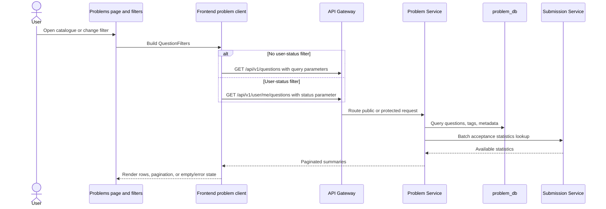

## Purpose and scope

This chapter follows the catalogue list request rather than every Problem Service endpoint. It is intended for someone adding a filter, changing a problem-summary field, or debugging an empty list. The list path is source-qualified for RC.8; it does not prove a live deployment route or every UI state.

## Catalogue request sequence

## Technical walkthrough

1. `getQuestions` serializes `QuestionFilters`: `page`, `size`, difficulty/tag inclusion and exclusion, search, company, sort, and order.
2. Without a `status` filter it uses the public questions endpoint through the frontend server API client. With `status`, it instead requests the authenticated user-questions endpoint; this keeps user-specific state separate from the public catalogue path.
3. `ProblemsController.listQuestions` builds `QuestionQuery`, parsing comma-separated tag filters and bounding the number of tag names.
4. `QuestionService` normalizes page/size, then composes a JPA specification for difficulty, excluded difficulty, included/excluded tags, title-or-id search, company, and optional include/exclude id sets. Sorting is by id by default, or title/difficulty when requested.
5. The service maps entities to summary DTOs. For a non-empty result it performs a batched Submission Service statistics lookup; unavailable/missing statistics result in nullable acceptance data rather than inventing an acceptance rate.
6. The frontend receives a paginated response and its page/table/filter components own presentation state. An empty page is a legitimate response; fetch failures remain an API-client/UI error.

## Implemented filter behavior

| Filter/input | Source-observed behavior |
| --- | --- |
| `search` | Matches title or id through `QuestionSpecification.titleOrIdMatches`. |
| `difficulty`, `tags`, `company` | Become predicates in the list query. |
| `excludeDifficulty`, `excludeTags` | Become exclusion predicates. |
| `sort`, `order` | Default is ascending id; title and difficulty have dedicated source handling. |
| `status` | Selects the authenticated user-question endpoint in the frontend client, rather than a public list parameter. |

The page is not a generic database search: only these observed parameters participate in the list path. The implementation bounds `size` and treats negative page input defensively. Details such as database indexes and SQL execution plans are outside this source evidence.

## Data, failure, and trust boundaries

Problem Service reads the `Question`/tag model from its `problem_db` ownership boundary. Its summary projection can request aggregated submission statistics but does not take ownership of submission records. The Gateway route configuration exposes public GET question/tag reads separately from protected variants; status-aware discovery requires an authenticated browser request.

- **Empty results:** `QuestionService` returns an empty Spring `Page`, including when an explicit include-id set is empty. This is not an error condition.
- **Invalid or unavailable request:** the frontend API client surfaces a non-OK response as an error; it does not manufacture a local result.
- **Statistics unavailable:** the summary mapper can leave rate/count fields absent. The source does not establish an end-user retry policy.
- **Authorization:** public catalogue reads and user-specific status reads have different Gateway route treatment. A UI filter does not grant access by itself.

## Source-to-flow references

<SourceReference repository="frontend" path="src/lib/api/problem-service.ts" label="Pinned frontend catalogue client" />
<SourceReference repository="problem" path="src/main/java/com/hrishabh/problemservice/controllers/ProblemsController.java" label="Pinned Problem Service list controller" />
<SourceReference repository="problem" path="src/main/java/com/hrishabh/problemservice/service/QuestionService.java" label="Pinned filtering and summary projection service" />

## Related reading

[Request routing and authentication](/docs/architecture/request-routing-and-authentication) · [Data ownership and persistence](/docs/architecture/data-ownership-and-persistence) · [Problem discovery user guide](/docs/using/problem-discovery) · [Run versus Submit](/docs/using/run-and-submit)
