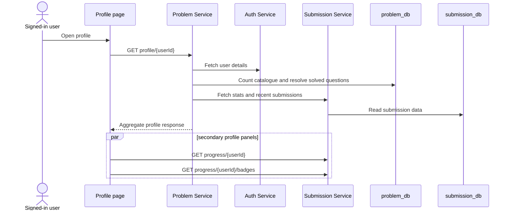

## Browser initialization

After the auth context resolves a signed-in user, the profile page requests the aggregate profile at `GET /api/v1/user/profile/{userId}?page=0&size=10`. It then requests progress and badges in parallel as a secondary operation. A failure of that secondary pair leaves the aggregate profile visible and clears only the rank/badge panels; failure of the main profile request produces the page-level error state.

## Aggregation boundaries

Problem Service is an aggregator, not the owner of every profile field. It reads catalogue counts locally, asks Auth Service for identity/profile fields, and asks Submission Service for solved ids, aggregate submission statistics, language statistics, and recent submissions. When solved ids are available, it deduplicates them and derives the difficulty breakdown from local question rows. If that list is empty, it falls back to Submission Service's statistics breakdown.

Recent submissions are also enriched with a local question title where available; otherwise the response uses a problem-id fallback title. The API response is therefore a composed view, not a single record owned by one database.

| View | Entry endpoint | Source-observed data source |
| --- | --- | --- |
| Core profile | `/api/v1/user/profile/{userId}` | Auth user data, local catalogue totals, Submission stats/solves/recent rows. |
| Heatmap | `/api/v1/user/heatmap/{userId}` | Submission Service activity data, mapped by Problem Service. |
| Daily streak | `/api/v1/user/streak/{userId}` | Published Problem Service daily schedule plus accepted submission days. |
| Solved filters | `/api/v1/user/me/solved-question-ids` and `/me/questions` | Submission solved ids combined with catalogue filtering. |
| Rank/badges | Submission Service progress endpoints | Derived `rank-v1` projection and earned badges. |

## Partial-data behavior

Auth lookup failure during core aggregation produces a fallback identity containing the requested user id so that the service can still attempt statistics. The streak method catches a runtime failure and returns an empty streak object. Heatmap validation follows a different path: an explicit false existence result is treated as not found, while an unavailable Auth Service is logged and the service continues to Submission Service.

These are source-level degradation rules, not availability guarantees. The profile controller maps an uncaught runtime failure from its aggregate method to a not-found response, so clients should not infer a precise upstream cause from that status alone. Similarly, browser-derived completion percentage is calculated from response values; it is not a separately persisted profile metric.

<SourceReference repository="problem" path="src/main/java/com/hrishabh/problemservice/controllers/UserProfileController.java" label="Pinned profile, heatmap, streak, and solved-list endpoints" />
<SourceReference repository="problem" path="src/main/java/com/hrishabh/problemservice/service/UserProfileService.java" label="Pinned cross-service profile composition and fallback rules" />
<SourceReference repository="frontend" path="src/components/profile/ProfilePage.tsx" label="Pinned main and secondary browser requests" />

## Related reading

[Accepted submissions, streaks, and progress](/docs/architecture/end-to-end-flows/accepted-submissions-streaks-and-progress) · [Rankings, badges, achievements, and leaderboards](/docs/architecture/end-to-end-flows/rankings-badges-achievements-and-leaderboards) · [Request routing and authentication](/docs/architecture/request-routing-and-authentication)
