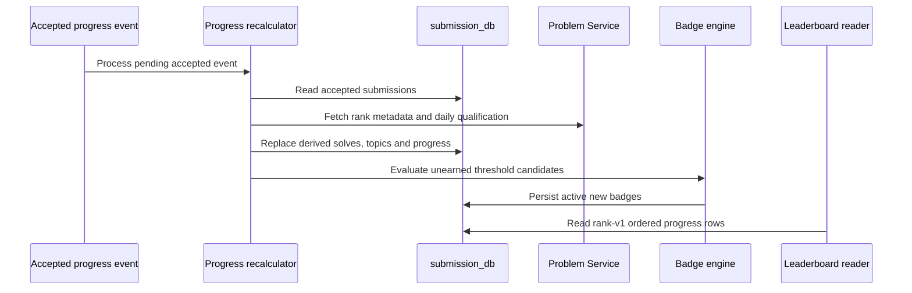

## Derived rank, not a direct submission counter

Rank and badges are derived in Submission Service when an accepted-submission outbox event is recalculated. The rebuild clears the user's prior derived rows, reads accepted submissions, retains the first accepted solve for each question, loads Problem Service metadata in batches, recreates qualifying daily completions, then persists `UserProgress`, topic rows, and newly earned badges. This is why profile and leaderboard values can lag the terminal submission verdict.



## Score inputs and tiers

For the default `rank-v1` configuration, total score is:

```text
mastery + POTD + topic breadth + quality + contest
```

Mastery is `10 × easy + 25 × medium + 45 × hard` for unique accepted, published questions with recognized difficulty. POTD is `6 × easy + 8 × medium + 10 × hard` for qualifying daily completions. Topic breadth is computed from normalized topic credits and capped at 300. The default tier thresholds are Novice 0, Bronze 100, Silver 300, Gold 700, Platinum 1500, Diamond 3000, and Master 6000.

The calculator currently assigns **zero** to both quality and contest. They are stored score components, not implemented ranking inputs in this source revision. The exact breadth contribution depends on the configured explorer/practitioner/specialist thresholds; the default configuration exposes credits of 1, 3, and 6 with 4, 10, and 18 points respectively. Treat these defaults as configuration, not immutable product policy.

## Badge eligibility and awards

The engine evaluates threshold candidates from derived progress:

- unique solves: 1, 10, 50, and 100;
- medium solves: 10 and 25; hard solves: 5, 10, and 25;
- qualifying POTDs: 1, 7, 30, and 100;
- longest POTD streak: 7 and 30;
- topic explorer: four topics at explorer credit, plus a graph-practitioner rule keyed by configured graph tag id or name.

An eligible code is persisted only if it is not already earned and an active badge definition exists. The source records the rank algorithm version and a rebuild source for awards. It does not establish a notification pipeline, badge revocation policy, or an independently scheduled achievement service.

## Read path and failure behavior

`GET /api/v1/progress/{userId}`, its badge subresource, and `GET /api/v1/leaderboard` require an identity header. The leaderboard reads `rank-v1` progress rows, bounds page size to 1–50, and returns position, score, tier, unique solves, hard solves, daily total, and a current-user marker. Rank progress is integrated into the profile as a secondary request: the frontend logs a progress failure and still displays the core profile.

Recalculation is a recovery tool as well as an event consumer because it rebuilds its derived state from accepted submissions and Problem Service metadata. But a missing metadata item does not count toward mastery, and a Problem Service or database failure can defer the outbox event. The implementation does not prove instant global rank updates or a live operational retry SLO.

<SourceReference repository="submission" path="src/main/java/com/hrishabh/algocracksubmissionservice/progress/service/ProgressRecalculationService.java" label="Pinned derived-state rebuild and metadata dependency" />
<SourceReference repository="submission" path="src/main/java/com/hrishabh/algocracksubmissionservice/progress/config/RankProperties.java" label="Pinned default score weights and tier thresholds" />
<SourceReference repository="submission" path="src/main/java/com/hrishabh/algocracksubmissionservice/progress/badge/ThresholdBadgeSupport.java" label="Pinned milestone badge thresholds" />
<SourceReference repository="submission" path="src/main/java/com/hrishabh/algocracksubmissionservice/progress/service/LeaderboardReadService.java" label="Pinned bounded leaderboard query and projection" />

## Related reading

[Accepted submissions, streaks, and progress](/docs/architecture/end-to-end-flows/accepted-submissions-streaks-and-progress) · [Profile and statistics retrieval](/docs/architecture/end-to-end-flows/profile-and-statistics-retrieval) · [Data ownership and persistence](/docs/architecture/data-ownership-and-persistence)
