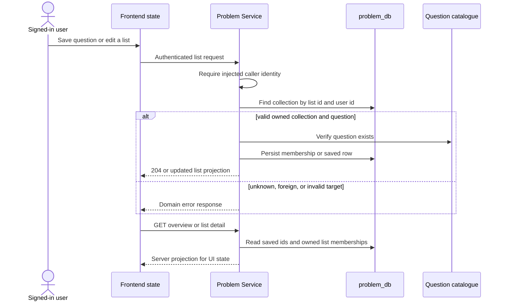

## Entry points and participants

Saved questions and named custom lists are Problem Service data, reached through `/api/v1/problem-lists`. The controller requires the gateway-injected user id for every operation. The browser client uses the ordinary authenticated API client, so an unauthenticated response follows that client's sign-in handling rather than exposing a separate lists credential model.

## Persisted model versus browser state

The built-in **Saved** collection is backed by `SavedProblem` rows keyed by user and question. Custom lists use a list row and list-item membership rows. The overview endpoint returns saved problem ids and each custom list's member ids; a detail request resolves those ids to current question summaries. Missing question rows are skipped when building a detail response rather than resurrecting stale catalogue data.

The frontend's API module is a transport layer: it fetches the overview/detail projection and performs mutations, but it is not a second source of truth. A UI may keep temporary selection, dialogs, filters, or optimistic presentation state, yet the next overview/detail fetch is the server-owned membership state.

## Rules, idempotency, and ownership

| Operation | Source-observed rule |
| --- | --- |
| Save | Existing saved membership is a no-op; a missing question is rejected. |
| Unsave | Deletes by caller and question; removal of an absent membership is harmless. |
| Create custom list | Normalizes whitespace, requires a name, reserves “Saved”, enforces case-insensitive uniqueness per user, and caps a user at 100 lists. |
| Add to custom list | Requires an owned list and an existing question; duplicate add is a no-op; each collection is capped at 500 problems. |
| Remove from custom list | Removes the membership if present and updates the list timestamp only when a row was removed. |
| Update/delete | Looks up by `(listId, userId)`; a list owned by somebody else is presented as not found. List-item rows use database cascade on list deletion. |

The cap and normalization rules protect the persistence boundary rather than merely controlling UI affordances. They also mean a client should not assume a successful-looking local update has committed until the request completes.

## Empty and failure states

An empty saved set or custom list is a valid server result, not an error. Invalid list input, duplicate custom names, collection-limit overflow, and missing questions are domain failures. The source does not establish an offline queue or automatic client retry for list mutations. The user should therefore treat a failed request as uncommitted and refetch the server projection when a reliable view is needed.

<SourceReference repository="problem" path="src/main/java/com/hrishabh/problemservice/controllers/ProblemListController.java" label="Pinned authenticated list endpoints" />
<SourceReference repository="problem" path="src/main/java/com/hrishabh/problemservice/service/ProblemListService.java" label="Pinned ownership, cap, and idempotency rules" />
<SourceReference repository="frontend" path="src/lib/api/problem-lists-service.ts" label="Pinned browser list client" />

## Related reading

[Problem retrieval and discovery](/docs/architecture/end-to-end-flows/problem-retrieval-and-discovery) · [Authentication and session establishment](/docs/architecture/end-to-end-flows/authentication-and-session-establishment) · [Data ownership and persistence](/docs/architecture/data-ownership-and-persistence)
