## Purpose

This page is the global architecture view of execution. It explains **why orchestration and untrusted code run in different processes**, without reproducing the runner's lease, Lua, or NsJail lifecycle internals. Those are D3.5 material.

The relevant terms are:

- **CXE orchestrator:** the HTTP-facing Code Execution Engine component that validates/routs execution requests and provides status/result access.
- **Persistent runner:** a plain Java worker workload with no public HTTP service; it claims work and launches sandbox child processes.
- **NsJail child:** a fresh process for one compile or run stage. User-provided program/source reaches this boundary, not the API process.
- **Trusted oracle:** the reference-solution stage of an official Submit. It is a distinct stage after user-code execution, not a browser-supplied program.

## Trust-boundary diagram

```mermaid
flowchart LR
  classDef trusted fill:#dcfce7,stroke:#15803d,color:#14532d
  classDef control fill:#e0f2fe,stroke:#0369a1,color:#082f49
  classDef queue fill:#ffedd5,stroke:#c2410c,color:#431407
  classDef untrusted fill:#fee2e2,stroke:#b91c1c,color:#450a0a
  classDef fallback fill:#f3f4f6,stroke:#6b7280,color:#111827

  Browser[Browser user source and inputs]:::untrusted
  Submission[Submission Service<br/>domain workflow and finalization]:::trusted
  CXE[CXE orchestrator<br/>validate, route, status]:::control
  Redis[(Redis v2 coordination state)]:::queue
  Runner[Persistent runner<br/>claim, workspace, launcher]:::control
  Jail[NsJail child<br/>fresh compile or run stage]:::untrusted
  Result[Bounded execution outcome]:::queue
  Legacy[Retained Job/local paths]:::fallback

  Browser --> Submission
  Submission -->|execution request / poll| CXE
  CXE -->|publish / observe| Redis
  Redis -->|claimed task| Runner
  Runner -->|allowlisted process inputs| Jail
  Jail --> Result
  Result --> Runner
  Runner -->|conditional terminal result| Redis
  Redis --> CXE
  CXE --> Submission
  Legacy -.->|compatibility or rollback, not default path| CXE
```

## What the separation accomplishes

Submission Service remains responsible for the submission-domain workflow: it has the problem/test/oracle context and finalizes a domain outcome. CXE is responsible for accepting an execution request, applying execution policy/routing, publishing the asynchronous work, and exposing status/results. The runner owns neither a public HTTP API nor submission persistence; it focuses on work claiming, workspace lifecycle, sandbox launch, and result handoff.

That separation reduces the blast radius of untrusted program execution. In the Helm source, the runner has a dedicated no-token service account, non-root security context, read-only root filesystem, restricted volumes, no ingress, and limited egress to DNS/Redis. Source evidence shows the intended boundaries; it is not a blanket proof that a particular host kernel, NsJail policy, or user program cannot escape them.

## Route scope: Java Run, Submit, and Playground

The CXE controller resolves an execution mode, validates ingress, and uses its backend router. When the router selects `PERSISTENT_NSJAIL`, the controller publishes v2 work; otherwise it retains legacy queue behavior. The source configuration makes explicit that routing is per mode rather than an unavoidable global choice.

| User-facing action | Source-observed coordination | Important qualification |
| --- | --- | --- |
| Java Run | Submission-side request reaches CXE; persistent routing can publish work for runner execution | Exact UI/API sequence is D3.3; deployment evidence for revision 19 is absent. |
| Official Submit | Submission workflow performs user execution and a trusted oracle stage sequentially | The architecture establishes two stages; it does not claim parallelism or a timing guarantee. |
| Java Playground | Playground has independent API/run enablement and can be routed to persistent NsJail for Java | Runtime visibility is independent of backend flags. Non-Java routing/feature behavior is not generalized here. |

## Retained paths and deliberate limits

- **Legacy/fallback:** Kubernetes Job and trusted local-process paths remain in CXE source. Their presence does not mean they are the default Java RC.8 route.
- **No automatic unsafe fallback:** the architecture plans distinguish a sandbox configuration/launch failure from permission to run the same source in an API process. This page does not publish implementation-specific fallback configuration.
- **Paused scope:** complexity analysis is not part of the runner migration or this D3.2 execution page.
- **Deferred detail:** execution v2 state transitions, stale token prevention, cancellation, output classification, resource measurement, and test matrix are deliberately deferred to D3.5 so that this diagram stays a trust-boundary explanation.

## Evidence

| Evidence | Record |
| --- | --- |
| Source | `AlgoCrack-SubmissionService` `fddf3d5…`, execution-facing modules; `CodeExecutionEngine` `c8e9c06…`, controller/routing/runner sources; `helm` `f32b8db…`, runner template |
| Supporting checks | RC.8 preparation record names atomic-move, JVM/v2 recovery, Playground NsJail, router/policy, and runner-probe gates |
| Status | Implemented but not deployment-qualified |
| Limitation | The record does not provide a revision-19 runtime capture, nor does it establish a universal sandbox-security guarantee. |

## Related reading

<SourceReference
  repository="cxe"
  path="nsjail-runner"
  kind="directory"
  label="Persistent runner source"
/>

[Data ownership](/docs/architecture/data-ownership-and-persistence) · [Container architecture](/docs/architecture/container-architecture) · [Observability architecture](/docs/architecture/observability-architecture) · [Run versus Submit](/docs/using/run-and-submit)
