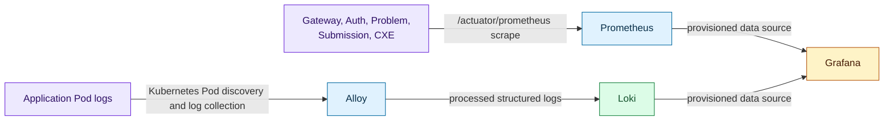

## Purpose

This page explains the source-observed telemetry paths, not an on-call procedure. It helps a developer reason about where to look when a cross-service request or execution result fails: application logs can be correlated by their structured fields, while Java backend metrics are scraped through actuator endpoints.

It does not claim that every service, dashboard, alert, retention policy, or runtime environment has complete telemetry coverage.

## Data-flow diagram

## Metrics path

The Helm monitoring template defines an `algocrack-backends` Prometheus scrape job with `/actuator/prometheus` as the metrics path. Its explicit targets are API Gateway, Auth Service, Problem Service, Submission Service, and CXE. This is why the diagram names the Java backend set instead of claiming frontend or runner metrics are scraped in the same way.

Prometheus configuration also contains a small, checked-in service-health/error-rate rule set. That establishes that the chart contains alert rules; it does **not** establish notification routing, operator response, or an SLO.

## Logs path

Alloy uses Kubernetes Pod discovery, keeps targets in the chart namespace, assigns service/container/pod/namespace labels, processes JSON fields such as `level`, and forwards the result to Loki. Grafana's provisioning configuration adds Prometheus and Loki as data sources and includes an overview dashboard definition.

For a developer, the practical consequence is correlation across two views:

1. Start with a request/submission/execution identifier in structured application logs where the emitting service records it.
2. Follow the request across gateway, domain service, CXE, and runner-related logs where those components emit matching identifiers.
3. Compare the time window with backend health or HTTP metrics in Prometheus/Grafana.

That is a diagnostic method, not proof that every log message contains every correlation field or that data is retained indefinitely.

## Execution troubleshooting boundary

The runner writes no public HTTP service in the chart. The runner's own readiness/liveness probes and Redis coordination signals are separate from the Prometheus backend scrape list. An execution issue can therefore require both the CXE status/result view and runner/Redis-oriented logs; it should not be diagnosed solely from frontend symptoms. Detailed runner counters and recovery semantics are D3.5 material.

## Evidence and limitations

| Evidence | Record |
| --- | --- |
| Source | `helm` `f32b8db…`, `algocrack/templates/monitoring.yaml`; gateway actuator configuration at `e61d5fd…`; checked-in observability material in `docker` `a53641c…` |
| Status | Implemented but not deployment-qualified |
| Limitation | Source proves configuration paths, not current dashboard data, alert delivery, retention, or full telemetry coverage in a revision-19 cluster. |

## Related reading

<SourceReference
  repository="helm"
  path="algocrack/templates/monitoring.yaml"
  label="Commit-pinned monitoring topology source"
/>

[Container architecture](/docs/architecture/container-architecture) · [Execution boundary](/docs/architecture/execution-coordination-and-trust-boundaries) · [Data ownership](/docs/architecture/data-ownership-and-persistence)
