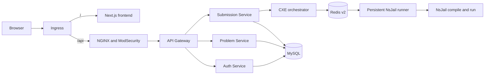

RC.8 keeps the product API and the untrusted process apart. Spring Boot services own HTTP, identity, and rows in MySQL. A plain Java runner, with no public HTTP port and no Kubernetes API access, starts NsJail for compile and run.

## Request path

1. Ingress sends `/` to the frontend and `/api` to the WAF. The API gateway is not the ingress backend for `/api`.
2. The gateway checks the JWT and sets identity headers from that token. It does not trust a caller-supplied user id.
3. Auth Service owns accounts and token signing. Problem Service owns the catalogue, lists, profiles, and the daily schedule. Submission Service owns submission rows, judging, progress, and the Playground API.
4. Each of those three services uses its own MySQL schema. Redis is the execution queue and status store, not the system of record for users or submissions.
5. For a Java submission or Java Playground run, the Code Execution Engine orchestrator publishes a versioned task. The runner claims it, then starts a fresh NsJail process for compilation and another for execution.

Official Submit still does two executions: the user solution and a reference solution. Playground does not. It has no question and no oracle.

## What the diagram does not include

The Kubernetes Job path and the local-process path are still compiled into the execution engine. They are fallbacks. They are not boxes on the RC.8 request path above.

Complexity profiling is also omitted. It is not part of the user-facing RC.8 route.

The runner and the orchestrator are two images built from the same `CodeExecutionEngine` commit and different Dockerfiles. Only the orchestrator is a Spring Boot application.

## Sources

- `helm` `f32b8db734b111e3e3c1acce636e90f068dcd0d9`, `algocrack/values.yaml` and `algocrack/templates/ingress.yaml`
- `CodeExecutionEngine` `c8e9c069e384d56a5ba3a01e370188db88ec05ba`, `Dockerfile` and `Dockerfile.runner.packaged`
- `AlgoCrack-APIGateway` `e61d5fd86b116119e59c0536cdc88953d3510cc7`, gateway route configuration
