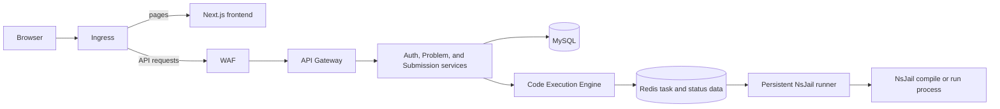
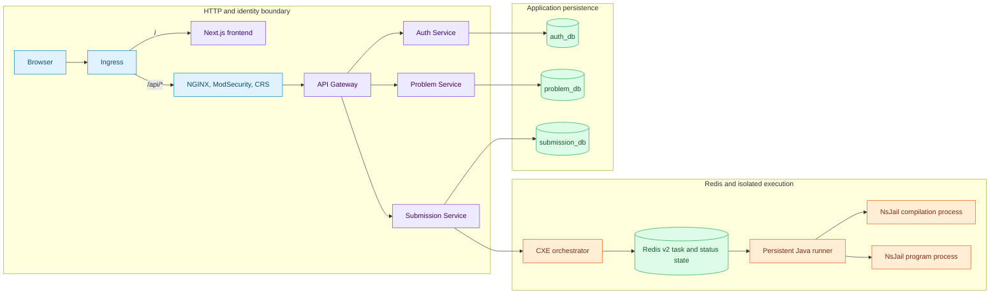

RC.8 source evidence keeps the product API and untrusted code execution apart. The browser uses HTTP services for product actions; a separate plain-Java runner consumes execution work and creates fresh NsJail processes for compilation and execution. The focused pages below carry the deployment-evidence qualification: the checked-in record does not include a revision-19 manifest/values capture.

## Start with the architecture learning path

This page is a short orientation retained from D2. For the source-backed engineering path, read the focused pages in this order:

1. [System context](/docs/architecture/system-context)
2. [Container architecture](/docs/architecture/container-architecture)
3. [Request routing and authentication](/docs/architecture/request-routing-and-authentication)
4. [Data ownership and persistence](/docs/architecture/data-ownership-and-persistence)
5. [Execution coordination and trust boundaries](/docs/architecture/execution-coordination-and-trust-boundaries)
6. [Observability architecture](/docs/architecture/observability-architecture)
7. Service deep dives — planned D3.4 work

## System overview

Use this diagram first: it shows the major responsibilities without treating every implementation detail as an architectural boundary.

The [Getting started](/docs/using/getting-started) and [Run versus Submit](/docs/using/run-and-submit) guides explain what this means for a user. The planned engineering reference will expand each boundary without turning this orientation page into a component diagram.

## RC.8 container-level HLD

The fuller view separates inbound HTTP, application persistence, and the execution path. Arrows indicate known request or work direction, not a claim that every service communicates with every other service.

### What this diagram establishes

1. `/` is a frontend route, while `/api/*` goes through the WAF before the internal gateway.
2. Auth, Problem, and Submission Service own separate MySQL schemas. Redis coordinates execution work and status; it is not the canonical store for user or submission records.
3. The runner has no public HTTP listener. It receives versioned execution work from Redis and starts a new NsJail process for each compile and run stage.
4. An official Submit requires two execution lifecycles: the user solution followed by the trusted reference solution. A Playground run has no problem or oracle.

## Boundaries that need deeper reading

- [Platform features and Java support](/docs/using/features) distinguishes shipped Java paths from saved or retained language options.
- [Run versus Submit](/docs/using/run-and-submit) gives the user-facing result and error lifecycle.
- [Documentation diagram standards](/docs/developer/diagram-standards) explains why later diagrams are split by reader question and not overloaded.
- [Repository map](/docs/architecture/repositories) identifies the repository that owns each part of this picture.

## Retained paths and scope

The Kubernetes Job executor and a trusted local-process executor remain in the Code Execution Engine as compatibility and rollback paths. They are not boxes on the RC.8 Java request path shown above. Complexity analysis is likewise out of scope for this user and architecture overview.

## Sources

<SourceReference
  repository="helm"
  path="algocrack/templates/ingress.yaml"
  label="Ingress topology source"
/>

- `helm` `f32b8db734b111e3e3c1acce636e90f068dcd0d9`, `algocrack/templates/ingress.yaml`, `algocrack/templates/code-execution-engine.yaml`, and `algocrack/templates/cxe-nsjail-runner.yaml`
- `CodeExecutionEngine` `c8e9c069e384d56a5ba3a01e370188db88ec05ba`, `Dockerfile`, `Dockerfile.runner.packaged`, and `nsjail-runner/**`
- `AlgoCrack-APIGateway` `e61d5fd86b116119e59c0536cdc88953d3510cc7`, `src/main/resources/application.yml`
