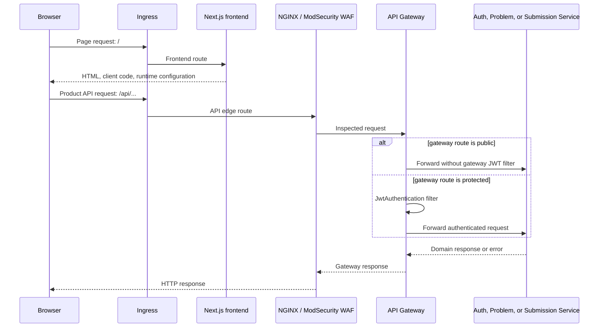

## Purpose

This page documents the source-observed request boundary from browser to a domain service. It uses the **gateway route configuration** as the authority for public versus JWT-filtered paths; controller annotations alone do not establish browser exposure.

**Terminology:** an *edge route* is an Ingress path; a *gateway route* is a Spring Cloud Gateway predicate and filter chain; a *domain service* owns the downstream HTTP handler and domain behavior.

## Request path

## Observed routing groups

The chart's ingress values map `/` to the frontend and `/api` to the WAF service. The WAF is therefore an API-edge hop in this topology; it is not the frontend's runtime configuration endpoint or a replacement for gateway authorization.

The gateway configuration then supplies the relevant route grouping:

| Gateway path group | Downstream service | Gateway treatment observed in source |
| --- | --- | --- |
| `/api/v1/auth/**` | Auth Service | No `JwtAuthentication` gateway filter on this route group. |
| `GET /api/v1/questions/**`, tags, test cases, and solutions | Problem Service | Explicit public GET routes precede protected variants. |
| Remaining question/tag/test-case/solution methods; problem lists; user profile | Problem Service | `JwtAuthentication` configured on the protected route groups. |
| `GET /api/v1/daily-challenges/**` | Problem Service | Public read route. |
| Admin daily/POTD routes | Problem Service | JWT filter at the gateway; downstream role rules are outside this page. |
| `/api/v1/submissions/**`, progress, badges, leaderboard | Submission Service | JWT filter at the gateway. |
| `/api/v1/playgrounds/**` | Submission Service | JWT filter at the gateway. Feature enablement remains independent of visibility. |

This table does not promise that a listed endpoint is enabled in every environment, nor does it replace downstream validation or authorization. It records the gateway configuration at the RC.8 source pin.

## Authentication boundary

The gateway has the public-key side of the configured JWT setup and applies the `JwtAuthentication` filter where its routing file says to apply it. The Auth Service remains the domain owner for authentication-related behavior. The source includes configurable OAuth client settings, but documentation does not reveal configuration values or claim that a particular provider/client is active.

The frontend makes requests through its API-client layer. It is not an authorization authority: hiding a navigation item or returning a runtime feature flag cannot make a protected downstream API public. Similarly, enabling a backend Playground API/execution flag remains independent from the frontend's runtime visibility flag.

## Error boundaries

- **Before the gateway:** an Ingress or WAF decision can stop an API request before a domain service is reached. D3 intentionally does not publish raw WAF exclusions or bypass material.
- **At the gateway:** an unmatched route, invalid JWT, or filter failure is an edge/gateway concern; the domain controller is not reached through that path.
- **At the service:** domain validation, persistence, and execution-result errors are shaped by the receiving service. [Execution coordination](/docs/architecture/execution-coordination-and-trust-boundaries) covers the separate execution boundary.
- **At the browser:** the UI can surface an HTTP failure, but it does not change the server-side decision.

## Evidence

| Evidence | Record |
| --- | --- |
| Source | `helm` `f32b8db…`, `algocrack/values.yaml` and ingress template; `AlgoCrack-APIGateway` `e61d5fd…`, `application.yml`; `frontend` `c859bc…`, `src/lib/api/**` |
| Status | Implemented but not deployment-qualified |
| Limitation | The checked-in evidence has no revision-19 rendered route/values capture. Route availability is not inferred from controller mappings. |

## Related reading

<SourceReference
  repository="apiGateway"
  path="src/main/resources/application.yml"
  label="Commit-pinned gateway route configuration"
/>

[Container architecture](/docs/architecture/container-architecture) · [Data ownership](/docs/architecture/data-ownership-and-persistence) · [Execution boundary](/docs/architecture/execution-coordination-and-trust-boundaries)
