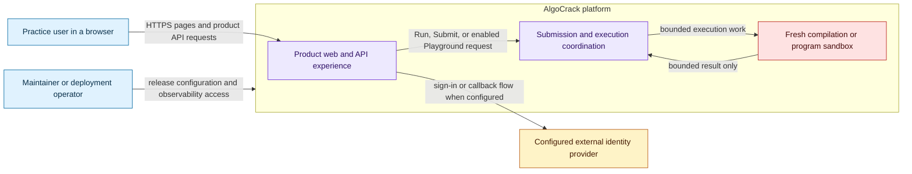

## Purpose

This C4 Level 1 page answers one question: **who interacts with AlgoCrack and where does trust change?** It intentionally does not describe controller methods, Redis keys, or NsJail internals. Follow it with [Container architecture](/docs/architecture/container-architecture) to see the deployable parts.

AlgoCrack is a programming-practice platform. A browser user discovers problems, runs code, submits solutions for judging, uses the Java Playground when it is enabled, and reads account-related results. The platform separates those product requests from untrusted program execution.

## Context diagram

### Reading the boundaries

- **Browser to product boundary:** the browser receives pages from the frontend and product APIs through the HTTP edge. The request-routing page records the observed `/` and `/api` split.
- **Identity boundary:** the gateway delegates the `/api/v1/auth/**` route group to the Auth Service without the gateway JWT filter. The Auth Service has OAuth-related configuration, but the source-qualified record does not prove a particular external provider is enabled in a running environment. That is why the diagram says *configured* provider.
- **Execution boundary:** code supplied by a user is not executed by the browser-facing API process. Submission/CXE coordination crosses into a separate runner, which starts a fresh sandbox process for compile and run stages. This is a design boundary, not a claim that every possible host or kernel risk is eliminated.
- **Operator boundary:** deployment and observability components are distinct from end-user routes. Operational commands and credentials are deliberately outside these public engineering pages.

## What this page does and does not prove

**Implemented but not deployment-qualified.** The diagram is based on pinned RC.8 source, Helm topology, and the RC.8 image manifest. The available checked-in release records identify Helm revision 18 and a proposed RC.8 upgrade; they do not contain a revision-19 manifest/values export or workload image IDs. The public [RC.8 release page](/docs/releases/v1.0.0-rc.8) carries the release baseline; the local D3 evidence and gap registers retain the reconciliation without turning it into an operational runbook.

The next pages make each source-observed boundary concrete:

1. [Container architecture](/docs/architecture/container-architecture)
2. [Request routing and authentication](/docs/architecture/request-routing-and-authentication)
3. [Data ownership and persistence](/docs/architecture/data-ownership-and-persistence)
4. [Execution coordination and trust boundaries](/docs/architecture/execution-coordination-and-trust-boundaries)
5. [Observability architecture](/docs/architecture/observability-architecture)

## Evidence

| Evidence | Record |
| --- | --- |
| Release | `v1.0.0-rc.8` source/image baseline |
| Source | `helm` `f32b8db…`, `algocrack/templates/ingress.yaml`; `frontend` `c859bc…`, `src/app/**`; `AlgoCrack-APIGateway` `e61d5fd…`, `src/main/resources/application.yml` |
| Status | Implemented but not deployment-qualified |
| Limitation | No checked-in revision-19 deployment capture was available for this documentation batch. |

## Related reading

- [Diagram standards](/docs/developer/diagram-standards)
- [RC.8 release baseline](/docs/releases/v1.0.0-rc.8)
- [Repository and microservice map](/docs/architecture/repositories)
