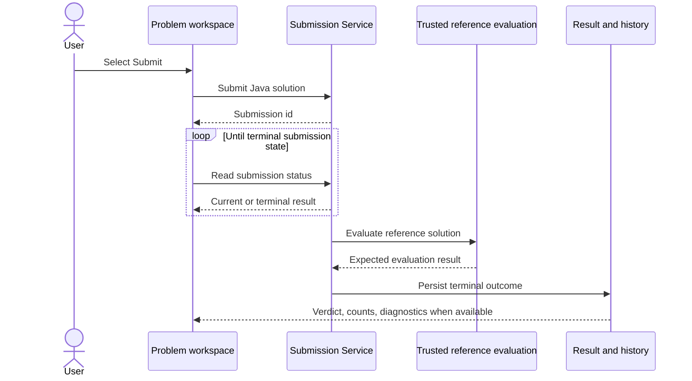

Use **Run** to check the code and cases currently in the editor. Use **Submit** when you want the official judgement and a submission record. Both require a signed-in user and a problem loaded in the workspace.

## At a glance

| | Run | Submit |
| --- | --- | --- |
| Main purpose | Iterate on visible and user-edited cases | Request official judging for the current problem solution |
| Request behavior | The frontend waits for the response | The frontend receives a submission id, then polls the submission record |
| Inputs | The cases currently in the test-case panel | The official submission payload; the UI does not send editor custom cases as the official test suite |
| Expected-output comparison | Yes; the service obtains a trusted reference result | Yes; accepted judgement includes trusted reference evaluation |
| History/progress | A run result in the workspace | A persisted submission outcome; accepted results can refresh solved and daily-challenge state |

## Run a solution

1. Select or add cases in the test-case panel.
2. Select **Run**.
3. Wait for the result panel to show the verdict and per-case results.
4. Correct code or input and run again as needed.

Run can return a passing or failing run verdict, compiler output, runtime error, timeout, and runtime/memory values where available. A successful Run is useful evidence for you; it is not the same as an accepted official submission.

## Submit a solution

1. Select **Submit** after reviewing your Java solution.
2. The frontend records the returned submission id and shows a judging state.
3. It polls the submission record until it reaches a terminal outcome or the in-page wait ends.
4. Read the final verdict in the result panel and submission history.

The user-facing sequence is deliberately simpler than the engineering execution design:

The diagram communicates the user contract. It omits Redis claims, leases, and NsJail process details; those belong to the planned engineering reference.

## Interpret common outcomes

- **Accepted**: the official comparison succeeded. The problem can refresh as solved, and a qualifying daily challenge can refresh its completion/streak state.
- **Wrong answer / failed run**: the produced result differs from the expected outcome for at least one evaluated case.
- **Compilation error**: the selected language/toolchain could not compile the code. Read the supplied compiler output.
- **Runtime error**: the program exited unsuccessfully while executing a case.
- **Time limit exceeded**: execution exceeded its configured time boundary. Reduce work or check for a non-terminating loop.
- **Infrastructure or request error**: the request itself did not complete normally. Preserve your code and try again; avoid repeatedly resubmitting while the earlier submission may still be pending.

## Important boundaries

- The trusted oracle is part of the judged flow. Do not treat a user-entered expected output as an official answer.
- Official Submit does not guarantee a particular response time; it has more work than a Run and is asynchronous from the frontend's perspective.
- A compiler/runtime diagnostic may be truncated by the execution path. It is not a full interactive shell transcript.

For standalone standard input/output experimentation, use [Playground](/docs/using/playground). For recovery advice, see [Troubleshooting and limitations](/docs/using/troubleshooting).

## RC.8 qualification

The frontend’s Run endpoint, Submit acknowledgement, polling behavior, and state refresh are verified in the RC.8 source. The dual user/reference execution is release-qualified implementation behavior; it is not a published performance guarantee.
